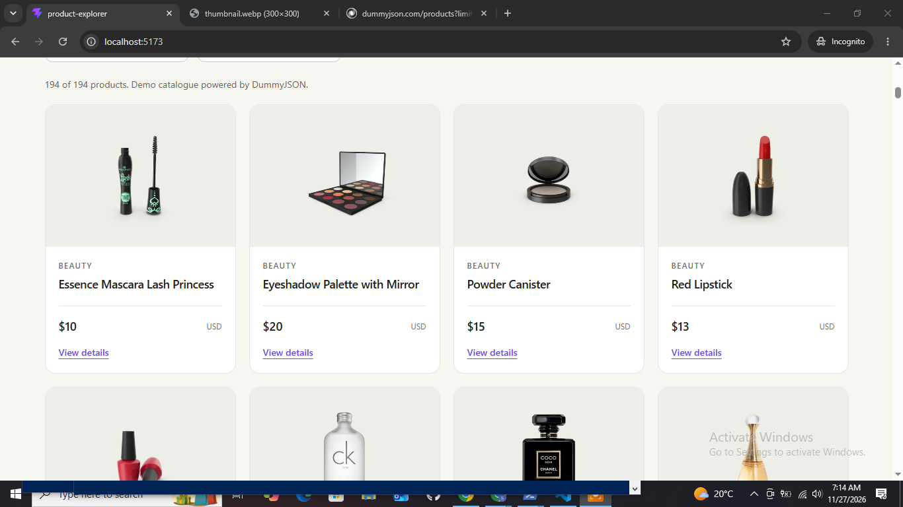
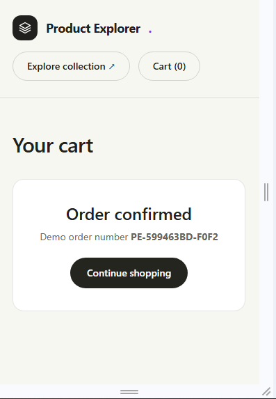

# Product Explorer

[Live demo](https://product-explorer-snowy.vercel.app/)

Product Explorer is a React storefront demo built with Vite and Tailwind CSS. Browse products from the DummyJSON API, open product details, and build a cart that stays available after a page refresh.

## Try the shopping flow

1. Search the catalog by product name, filter by price, or sort by name or price.
2. Open a product's details and add it to the cart.
3. Change the quantity and watch the total units and subtotal update.
4. Refresh the cart page to verify that the items and quantities are restored.

Guest checkout validates sample delivery details, offers Cash on delivery and Card (demo), and shows an order number after confirmation.

## How it works

- The catalog handles loading and failed requests, with a retry action.
- React state drives cart interactions. The checkout summary calculates units and subtotal from the current cart. USD prices display two decimal places.
- Add and quantity controls respect available stock. Out-of-stock products cannot be added.
- Saved cart items are checked against the API when the app reloads. Prices and excess quantities are updated, with a visible notice. Removed or sold-out products remain visible until you remove them.
- If the availability request fails, cart items remain visible. Retry is available; quantity changes and checkout wait for verification.
- The browser's localStorage saves product IDs, names, prices, and quantities. The storage service validates saved records and falls back to an empty cart when the data is invalid.
- The cart supports keyboard controls and adapts to narrow screens.

## Run locally

Use Node.js 22.20 or newer. In Windows PowerShell, use `npm.cmd` if `npm` is blocked.

    npm ci
    npm run dev

## Verify the project

    npm test
    npm run lint
    npm run build

The 15 automated tests cover cart persistence, invalid saved JSON, currency precision, duplicate additions, stock limits, invalid quantities, restored-cart reconciliation, and checkout eligibility.

## Demo limitations

Stock and prices are API snapshots, not inventory reservations. Availability can change after the last check. There is no order backend or real payment processing. Stock verification errors keep saved items intact until you retry or remove them.

## Screenshots

